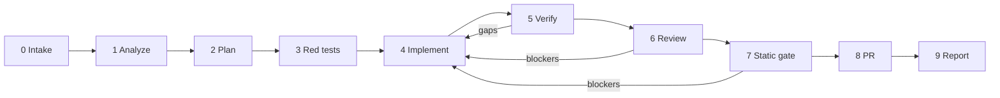

# AI-DLC Plugin — Design

## 1. Purpose

A plugin for coding assistants (Claude Code, Codex CLI, GitHub Copilot) that takes requirements — markdown files or Jira stories — and drives them through an agent pipeline to a reviewed pull request. It adds enterprise guardrails, end-to-end traceability, and per-run cost reporting.

## 2. Pipeline stages

| # | Stage | Model tier | Output artifact |
|---|-------|------------|-----------------|
| 0 | Intake + stack detection | fast / scripts | `requirements/<id>.md`, `stack-profile.json` |
| 1 | Requirements analysis & clarification | reasoning | `spec.md` |
| 2 | Planning / design, incl. dependency proposals | reasoning | `plan.md` |
| 3 | Red tests — failing tests written, then write-locked | coding | Failing tests (locked) |
| 4 | Implementation | coding | Commits on feature branch |
| 5 | Requirement verification — traceability matrix + spec-vs-diff check | reasoning | `verification.md` |
| 6 | Code review, on a different model than the implementer | reasoning | `review.md` |
| 7 | Static analysis gate — vulnerability scan, dead code, circular deps, duplication, complexity, API drift | deterministic tools | Gate results |
| 8 | PR + post-PR loop | fast | Pull request |
| 9 | Run report — per-stage time, token usage, estimated cost, retries, gate outcomes | deterministic | `reports/<run-id>.md` |

**Loops:** verification gaps (stage 5) and review or scan blockers (stages 6–7) route back to implementation (stage 4) with bounded retries.



## 3. Cross-cutting controls

- **`guardrails.yaml`** — policy enforced at two levels: in the prompt and at the tool level (hooks and harness block disallowed actions, not just ask the model to avoid them).
- **Action tiers** — every guarded action is `deny` (never overridable during a run; exceptions are reviewed org-policy changes), `ask` (an interactive developer may allow it once or for the run; headless runs deny it) or `allow`. Requests and decisions are audited and listed in the run report.
- **Harness** — git worktree isolation per run, command allowlist, path jail, scoped tokens, and an append-only audit log.
- **Gated dependency installs** — new dependencies are proposed in `plan.md` and checked for license, known CVEs, and approved registry before install.
- **Layered conventions** — enterprise → org → repo → project conventions, with more specific layers overriding general ones.
- **Isolated runtime** — command-text and path checks only see what an agent requests. For team use, agents run in a container (`integrations/container/`) that mounts only the repository, with egress limited to approved hosts and no cloud or deploy credentials. Write stages on agents without pre-tool hooks (Codex) require it.
- **Least-privilege security** — each stage gets only the permissions it needs; agents cannot escalate privileges.
- **Telemetry (opt-in)** — content-free run records and OpenTelemetry traces go only to the adopter's own collector when enabled; `AIDLC-Run` trailers join runs with PR outcomes. See [TELEMETRY.md](TELEMETRY.md).
- **Baseline-delta gating (brownfield)** — quality and security gates compare against the pre-change baseline, so only new issues introduced by the run block it.

## 4. Principles

1. **Artifacts over conversation** — every stage reads and writes files; chat history is not state.
2. **Bidirectional traceability** — requirement ↔ spec ↔ test ↔ code ↔ review, navigable both ways.
3. **Small verifiable increments** — work is sliced into units that can be tested and reviewed on their own.
4. **Red before green, with locked tests** — failing tests come first and are write-locked during implementation.
5. **Model proposes, harness disposes** — the LLM suggests actions; deterministic code decides and executes.
6. **Least privilege** — minimal tools, paths, and tokens per stage.
7. **Bounded retries with fail-fast** — loops have hard limits; stop and escalate instead of thrashing.
8. **Human gates by default** — approvals at key checkpoints unless explicitly disabled.
9. **Deterministic where possible** — scripts and tools over LLM calls whenever the task allows.
10. **Right model per phase** — implementer ≠ reviewer; tier routing is configured in `models.yaml`.
11. **Minimal sufficient context** — each sub-agent gets only the artifacts it needs.
12. **Portability across vendors** — no lock-in to a single assistant or model provider.
13. **Reversibility** — every change is on a branch/worktree and can be rolled back.
14. **Observability** — every stage emits timing, tokens, cost, retries, and gate outcomes.
15. **Separate agent identity** — the agent acts under its own identity and credentials, not the developer's.

## 5. Architecture

- **Deterministic orchestrator** (code, not an LLM) owns the state machine, loops, retries, and metrics.
- **Stateless sub-agents** receive a phase prompt, the input artifacts, and a model tier; they return output artifacts.
- **Independently invocable stages**, each declaring its input prerequisites and degrading gracefully when optional inputs are missing:

```bash
aidlc run --stage review          # single stage
aidlc run --from plan --to verify # stage range
aidlc run --only test,implement   # selected stages
```

## 6. Feasibility

- **Plugin layer** covers phase prompts, artifacts, MCP integrations, and hooks.
- **Companion `aidlc` CLI** is required for deterministic orchestration, real guardrail enforcement, sandboxing, and accurate cost reporting.
- A pure-markdown plugin (no CLI) delivers roughly **70%** of the design.

## 7. Proposed repo layout

```text
aidlc-plugin/
├── orchestrator/     # aidlc CLI: state machine, loops, retries, metrics
├── agents/           # phase prompts / sub-agent definitions
├── hooks/            # tool-level guardrail enforcement
├── scripts/          # deterministic helpers (intake, stack detection, gates, reports)
├── guardrails.yaml   # policy
├── models.yaml       # model tier routing per stage
├── mcp.json          # MCP integrations (Jira, etc.)
└── docs/
```

Runtime directory created in each target project:

```text
.aidlc/               # requirements, spec, plan, verification, review, reports, audit log
```

## 8. Usage

```bash
# One-time per project: generates .aidlc/ and aidlc.yaml
aidlc init
aidlc init --org <org>              # pull enterprise standards

# Run the pipeline
/aidlc run PROJ-123                 # from inside the assistant
aidlc run --ticket PROJ-123         # from the CLI, Jira story
aidlc run --file requirements/x.md  # from the CLI, markdown file

# Standalone stages
aidlc run --stage review

# CI (headless)
aidlc run --ticket PROJ-123 --headless
```

## 9. Build roadmap

| Milestone | Scope |
|-----------|-------|
| M1 | Contracts (artifact schemas, stage interfaces) + CLI skeleton |
| M2 | Vertical slice on Claude Code: intake → analyze → test → implement → verify → report |
| M3 | All stages + quality gates |
| M4 | Guardrails + Jira / MCP integration |
| M5 | Multi-assistant support + distribution |

**Key early decisions:**

- CLI implementation language.
- Claude Code as the first target assistant.
- Orchestrator owned by the CLI (not the plugin).
- Artifact format.
